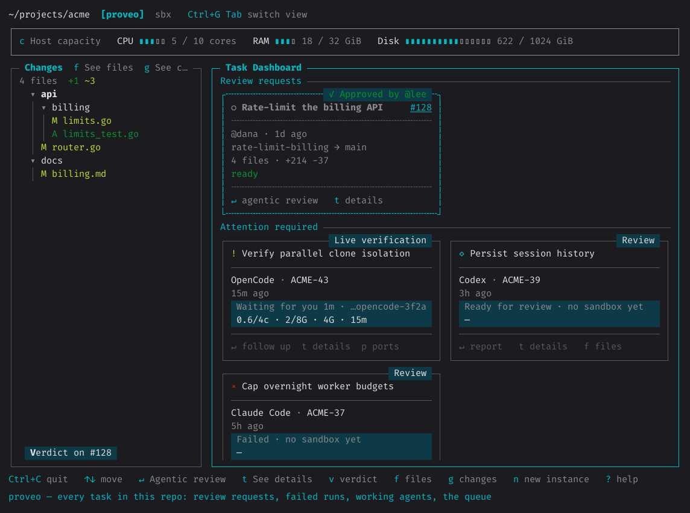

# Launch it

```sh
curl -fsSL https://proveo.ca/cli/install.sh | bash
```

<sub>Linux · macOS · FreeBSD. Windows: `irm https://proveo.ca/cli/install.ps1 | iex`. The installer ends with `proveo init`, which installs and signs in to [Docker Sandboxes](https://github.com/docker/sbx-releases) (sbx).</sub>

## Task Dashboard



<sub>Drawn from fixture data by `PROVEO_README_MEDIA=_spec/_assets go test ./internal/dashboard -run TestREADMEMedia`.</sub>

Run `proveo` in a repo to open the Task Dashboard. It holds every agent working on the repo, each in its own sbx microVM:

- **Review requests**: pull requests that ask for your review, with their checks, conflicts and approvals. `↵` starts an agentic review.
- **Attention required**: an agent waiting on you, a failed run (`r` retries, `x` cleans up), or an ended run (`↵` reads its report).
- **Working**: each running agent, with its sandbox's CPU, RAM and disk. `↵` attaches.
- **Queued**: runs waiting for a slot. `n` starts a new instance from a plan, a pull request or a Linear issue.

`Ctrl+G Tab` switches to the stock sbx view, and `?` lists every key.

## Simple run


<sub>Claude Code startup captured in Docker Engine using the published image.</sub>

Start one agent on the current repo with `proveo run <agent>` or the shorthand `proveo <agent>`.

```sh
proveo claudecode
```

Choose from `claudecode`, `codex`, `cursor`, `opencode`, and `hermes`.


The agent runs in an ephemeral sbx microVM, on a private clone of your repo.
sbx's proxy attaches your API keys, so the agent never holds them, and sbx's network policy decides
its egress. At teardown the agent's commits come home under `refs/proveo/<sid>`, and
`proveo adopt` turns them into a branch.

Select **Browser → isolated fresh** or pass `--addon browser` to browse inside the sandbox.
Open the viewport URL from the run's interface to monitor the agent or take control and sign in.
Use `--browser-profile work` to keep that workspace's logins in a named sandbox between runs.
Use `--addon chrome` for sign-in flows that require Chrome on the host.

- `proveo init` sets up sbx and checks your machine.
- `proveo clean` reclaims resources left by interrupted runs.

## Scheduling

`proveo schedule` runs agents unattended from `~/.proveo/schedule.yml`.
A minutely tick starts each due job in its own terminal, types its prompt once the agent is ready, and stops it at its budget.
This sample runs a fantasy-football team in two passes timed to kickoff, and triages a repo's issues every week:

```yaml
jobs:
  ff-lineup:                  # pass 1 of 2: injuries, byes, fill every slot, report
    target: hermes
    model: inkling-2-mini
    addons: [host-chrome]
    prompt_file: /Users/me/.proveo/prompts/ff-lineup.md
    budget: 36m
    tz: America/New_York
    at: ["thu 18:50", "sun 11:35", "sun 15:00", "sun 18:55", "mon 18:50"]
  ff-refine:                  # pass 2 of 2: reads pass 1's handoff from the shared workdir
    target: hermes
    model: inkling-2-mini
    addons: [host-chrome]
    prompt_file: /Users/me/.proveo/prompts/ff-refine.md
    workdir: /Users/me/.proveo/schedule/ff-lineup
    budget: 36m
    tz: America/New_York
    at: ["thu 19:32", "sun 12:17", "sun 19:37", "mon 19:32"]
  issue-triage:
    target: codex
    prompt_file: /Users/me/.proveo/prompts/issue-triage.md
    mode: plain
    budget: 30m
    at: ["thu 18:30"]
```

```sh
proveo schedule install                              # register the tick: launchd or systemd --user
proveo schedule                                      # every job, soonest run first, and its last result
proveo schedule run ff-lineup                        # start a job now
proveo schedule pause ff-lineup --until 2026-12-08   # hold its runs back; `resume` lets them run again
```

## Contributing

`mise run ci` (lint + test) gates every change, `mise run test-images` and `mise run e2e [--full]` are the image and sbx gates, and `mise run build|deploy [target] [--cli]` builds and ships the images and the CLI; details in [`CONTRIBUTING.md`](CONTRIBUTING.md).
